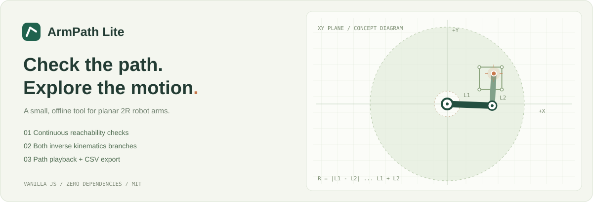

# ArmPath Lite

[](https://github.com/fcship625/armpath-lite/actions/workflows/test.yml)

项目仓库：[fcship625/armpath-lite](https://github.com/fcship625/armpath-lite)

**让路径先走一遍。** 一个不需要安装依赖的二维机械臂运动学与路径检查小工具。

A small, offline-first planar 2R robot arm playground. Check the **entire straight segment**, explore both IK branches, and export a sampled joint trajectory as CSV.



**JavaScript · 无运行依赖 · 浏览器本地计算 · MIT · 中文界面**

## 它解决什么问题？

画机械臂路径时，两个端点能到达，不代表连接它们的直线也能到达。

例如，L₁ = 140 mm、L₂ = 100 mm 时，可达半径为 40–240 mm。末端从 (−140, 0) 直线移动到 (140, 0)，两端可达，中间却穿过半径 40 mm 的盲区。

ArmPath Lite 会检查**整条线段的几何可达性**，把问题段标成橙色虚线，并阻止该路径的回放和 CSV 导出。检查独立于采样步长，因此增大步长也不会漏掉中间的盲区。

## 快速开始

下载仓库 ZIP 并解压，使用现代桌面浏览器打开 **`index.html`**。不需要 Node.js、不需要构建、不加载 CDN，也不需要账户。

1. 拖动橙色目标，或输入 X / Y 坐标。
2. 调整两段臂长，切换正肘角或负肘角分支。
3. 清空初始路径，将目标依次“添加为路点”；点击路点可查看姿态。
4. 检查路径状态，回放或拖动进度条。
5. 导出 CSV，或保存 JSON 工程供下次继续。

“载入圆形示例”生成 24 段直线组成的闭合圆近似；“试试盲区反例”展示端点可达而整段不可达的情形。也可通过“打开工程”载入 `examples/` 中的 JSON。

连续打开多个工程时，以最后选择的文件为准。目标坐标输入保留实际数值精度，例如 `-0.01` 不会被显示成 `-0.0`；画布注释和路点列表仍采用紧凑读数。

如需通过本地服务器访问，安装 Node.js 22 或更新版本，然后在项目目录执行：

```sh
npm start
```

打开终端显示的 `http://127.0.0.1:4173`，按 Ctrl+C 停止。无需执行 `npm install`。

## 功能

- 二维 2R 机械臂、工作空间圆环与双分支解析逆运动学。
- 20–300 mm 整数臂长调整，坐标数值输入，点击与拖动目标。
- 路点列表、连续线段可达性检查、内侧盲区提示。
- 奇异性指标 `|sin θ₂|`：0 为奇异位形，1 为该指标最大；**不是安全评分**。
- 分段直线采样，保留拐角，基于弧长和末端速度计算时间戳。
- 肩关节角展开，避免穿过 atan2 分支边界时出现约 360° 的数值跳变。
- 轨迹回放、CSV 导出、带格式和大小校验的 JSON 工程导入导出。
- 不上传工程数据；刷新页面前请手动保存工程。

## 模型与算法

坐标系：原点在肩关节，X 向右、Y 向上；连杆长与末端位置单位为 mm。θ₁ 相对 +X 轴，θ₂ 相对第一段连杆，逆时针为正。内部角度使用 rad；界面和 CSV 使用 deg。

```text
x = L₁ cos θ₁ + L₂ cos(θ₁ + θ₂)
y = L₁ sin θ₁ + L₂ sin(θ₁ + θ₂)

c₂ = (x² + y² − L₁² − L₂²) / (2 L₁ L₂)
θ₂ = branch × acos(clamp(c₂, −1, 1))
θ₁ = atan2(y, x) − atan2(L₂ sin θ₂, L₁ + L₂ cos θ₂)
```

可达半径为 `[|L₁ − L₂|, L₁ + L₂]`。对每条线段，最大半径出现在端点；最小半径通过原点在线段上的投影求得，再与可达半径比较。这是连续几何检查，不是密集采样近似。

两段臂长相等且末端位于原点时，肩关节角不唯一。界面展示一组参考姿态；穿过或触及该点的路径不生成轨迹。内外边界属于可达域，但属于奇异位形，会给出提示。路径的最小奇异性指标根据线段径向极值计算，即使粗采样没有恰好落在奇异点，也会提示。

## CSV 格式

```text
time_s,x_mm,y_mm,q1_deg,q2_deg,singularity_index,l1_mm,l2_mm,branch,speed_mm_s
```

| 字段 | 含义 |
| --- | --- |
| `time_s` | 从第一个路点开始的理想路径时间，单位 s |
| `x_mm`, `y_mm` | 末端位置，单位 mm |
| `q1_deg`, `q2_deg` | 肩关节角、相对肘关节角，单位 deg |
| `singularity_index` | 当前采样点的 `|sin θ₂|` |
| `l1_mm`, `l2_mm` | 本次导出的模型臂长 |
| `branch` | +1 正肘角分支，−1 负肘角分支 |
| `speed_mm_s` | 指定的理想末端速度 |

最大步长控制相邻采样点的距离；每段端点都会保留，时间间隔不一定相同。重合路点不生成重复时间戳。肩关节角为了保持连续，可能超出 ±180°，没有按电机角度范围截断。CSV 为普通 UTF-8、逗号分隔，包含表头。

靠近奇异位形时，即使两点之间的末端距离很短，肩关节也可能真实转动超过 180°。v1.0.2 按路径极角展开肩关节角，避免粗采样把它错误地折回另一整圈；建议减小最大步长来观察这类变化。可导入 `examples/coarse-step.json`，比较 20 mm 与 0.5 mm 步长导出的终点肩关节角，两者应一致。这个示例接近奇异位形，仅供几何分析。

## 适用范围

这是几何学习与路径预检查工具，模型假设关节无限旋转，不考虑关节限位、自碰撞、障碍物、负载、加速度、扭矩和电机零位。分段恒速模型在拐角处速度方向突变，未进行加减速或转角平滑。回放从第一个路点开始，不规划当前目标到首路点的过渡。

CSV 用于分析和继续开发，不能直接作为实机控制指令；接入硬件前，需要独立完成约束、标定与轨迹处理。

## 开发与测试

Node.js 22+，无第三方依赖：

```sh
npm test
```

也可直接执行 `node tests/run.cjs`。28 项测试覆盖正逆解回代、两种分支、边界与退化、整段盲区检查、连续奇异性检查、粗细采样与多圈角度展开、CSV、工程验证、异步导入顺序和目标精度、界面事件逻辑，以及本地预览服务器的真实 HTTP 请求。服务器测试仅监听临时的本机端口，不访问外部网站。界面逻辑测试使用轻量 DOM 替身，**不验证真实浏览器布局**。GitHub Actions 已配置 Node.js 22 / 24 测试任务。

```text
index.html                 页面入口，可直接打开
styles.css                 响应式界面
src/kinematics.js          独立计算核心，可在浏览器 / Node 中使用
src/app.js                 界面交互、回放与文件导出
tests/                     数学与界面事件逻辑测试
examples/                  可导入的示例工程
scripts/serve.cjs           仅绑定本机的预览服务器
docs/                      算法示意与 GitHub 发布指南
.github/workflows/test.yml  自动测试
LICENSE                    MIT 许可证
```

核心复用示例：

```js
const { inverse, plan, toCSV } = require('./src/kinematics.js');
const pose = inverse(140, 100, 145, 95, 1); // angles in radians
const config = {
  l1: 140, l2: 100, branch: 1, speed: 60, step: 2,
  waypoints: [{ x: 100, y: 50 }, { x: 150, y: 90 }]
};
const trajectory = plan(config);
if (trajectory.valid) console.log(toCSV(trajectory, config));
```

## 发布与贡献

参见 [GitHub 发布指南](docs/PUBLISH.zh-CN.md) 与 [贡献指南](CONTRIBUTING.md)。这是静态项目，可直接使用 GitHub Pages 展示，部署不需要构建。

后续可贡献的独立小功能：关节限位、速度曲线、路点排序、英文界面。当前版本有意保持轻量。

最新维护：[2026-10-22 19:30 维护记录](docs/maintenance/2026-10-22-1930.md)；此前的 [v1.0.2 晚间记录](docs/maintenance/2026-10-22-evening.md)、[v1.0.1 维护记录](docs/maintenance/2026-10-22.md) 和版本变化 [CHANGELOG](CHANGELOG.md) 均予保留。

## 来源与许可证

本项目的代码、界面与文档在本次开发中编写，没有从现成机械臂仓库复制代码，没有第三方运行依赖、字体或图片素材。运动学公式与线段投影属于通用数学方法；项目不主张这些方法或“二维机械臂工具”概念为首创，也不保证全球不存在相似项目。

学习参考：[CMU — An Introduction to Robot Kinematics](https://www.cs.cmu.edu/~16311/ppp/Kinematics_final.pdf)。该链接仅作学习参考，不包含其代码或插图。

Copyright (c) 2026 **ArmPath Lite contributors**。项目采用 [MIT License](LICENSE)。MIT 允许使用、修改和再分发等行为，要求保留版权和许可声明；许可证说明见 [Choose a License](https://choosealicense.com/licenses/mit/) 与 [GitHub 官方许可文档](https://docs.github.com/en/repositories/managing-your-repositorys-settings-and-features/customizing-your-repository/licensing-a-repository)。
